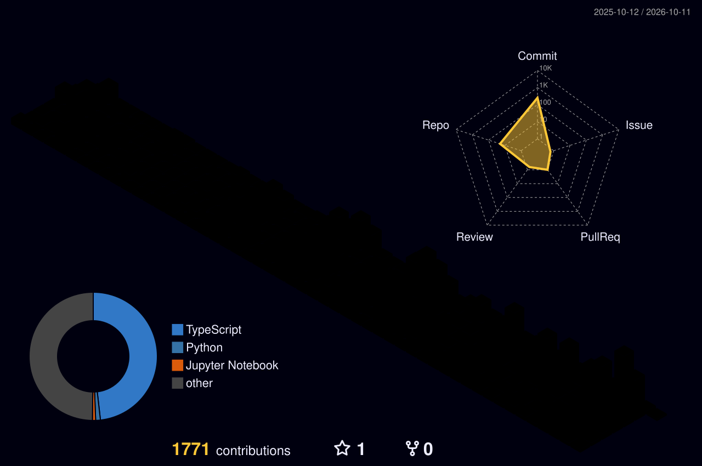

<p align="center">
  <a href="./README.pt.md">🇲🇿 Ler em Português</a>
  &nbsp;•&nbsp;
  
</p>

<p align="center">
  <a href="https://www.linkedin.com/in/domingos-alfredo-8b108626b">
    
  </a>
  <a href="mailto:domingosalfredotimane@gmail.com">
    
  </a>
  <a href="https://github.com/Domingos-Jr17">
    
  </a>
</p>

<p align="center">
  <a href="https://git.io/typing-svg">
    
  </a>
</p>

---

### 🧠 About Me

- 🎓 Civil Engineering student at Universidade Eduardo Mondlane (2nd year)
- 💻 Fullstack Developer at Byte For You (Aga Khan & Maputo Municipality program)
- 🔭 Currently building [**Obras Moz ERP**](https://github.com/Domingos-Jr17/obras-moz-erp) — management system for the construction sector in Mozambique
- 🤖 Passionate about AI applied to African contexts: local languages, urban mobility, and health
- ♟️ Chess Teacher at Colégio Wisdom | logic, strategy, and teaching
- 💡 Entrepreneur focused on tech solutions for civil engineering and education in Africa
- 🏆 Active participant in national and international hackathons
- 📫 Email: **domingosalfredotimane@gmail.com**

---

### 💻 Tech Stack

#### Languages


#### Frontend


#### Backend & Databases


#### DevOps & Tools


#### AI & Data Science


---

### 🌟 Featured Projects

#### 🏗️ Construction & ERP

| Project | Description | Stack |
|---------|-------------|-------|
| [**Obras Moz ERP**](https://github.com/Domingos-Jr17/obras-moz-erp) | Integrated management system for the construction sector in Mozambique | TypeScript, PostgreSQL, Docker |

#### 💼 Recruitment & Jobs

| Project | Description | Stack |
|---------|-------------|-------|
| [**Ku Thola**](https://github.com/Domingos-Jr17/ku-Thola) | Digital recruitment platform with CV upload | TypeScript, React |

#### 🎓 Education & Community

| Project | Description | Stack |
|---------|-------------|-------|
| [**Ninteku EduCore**](https://github.com/Domingos-Jr17/ninteku_educore) | Educational platform with relational database | TypeScript, PostgreSQL |
| [**Colégio Wisdom**](https://github.com/Domingos-Jr17/Colegio_wisdom) | Institutional website for a private school | TypeScript, React |
| [**Appto**](https://github.com/Domingos-Jr17/appto) | Full-stack application with auth, Fastify backend and PostgreSQL | TypeScript, Fastify, PLpgSQL, Docker |

#### 🤖 AI & Data

| Project | Description | Stack |
|---------|-------------|-------|
| [**Hack Saúde**](https://github.com/Domingos-Jr17/hack-saude) | AI solution applied to public health in Mozambique | Python, TypeScript |
| [**Maputo Mobility 2025**](https://github.com/Domingos-Jr17/2025-maputo-mobility-prediction-hackathon-powered-by-yango20250909-4999-1n9o0z7--1-) | Urban mobility prediction with ML (Yango Hackathon) | Python, ML |
| [**StreamViz Dashboard**](https://github.com/Domingos-Jr17/StreamViz-Dashboard) | Real-time data visualization dashboard | TypeScript |

#### 🌍 Social Innovation

| Project | Description | Stack |
|---------|-------------|-------|
| [**MoCity+**](https://github.com/LucoVilanculos/MoCity) | Urban platform for young people in Mozambique | TypeScript |
| [**Yisa**](https://github.com/Domingos-Jr17/yisa) | Social solution built at Source Jam 2025 | TypeScript |
| [**Map App**](https://github.com/Domingos-Jr17/Map-App) | Interactive mapping application | TypeScript |

#### 🔧 Tools & Automation

| Project | Description | Stack |
|---------|-------------|-------|
| [**Automatic Certificate**](https://github.com/Domingos-Jr17/automatic-certificate) | Automated certificate generator | JavaScript |
| [**Platform Website**](https://github.com/Domingos-Jr17/platform_website) | Platform landing & dashboard | TypeScript |

---

### 🏆 Hackathons & Competitions

| Event | Year | Focus |
|-------|------|-------|
| [UNODC Hackathon](https://github.com/Domingos-Jr17/UNODC-Hackathon) | 2026 | Public safety tech solution |
| [Hack Saúde](https://github.com/Domingos-Jr17/hack-saude) | 2026 | AI for public health in Mozambique |
| [Source Jam](https://github.com/Domingos-Jr17/source_jam_2025_yisa) | 2025 | Social innovation — Yisa project |
| [Yango Mobility Prediction](https://github.com/Domingos-Jr17/2025-maputo-mobility-prediction-hackathon-powered-by-yango20250909-4999-1n9o0z7--1-) | 2025 | Urban mobility ML in Maputo |
| [Cost-FU Hackathon](https://github.com/Domingos-Jr17/cost---fu-hackathon) | 2025 | Financial management solution |

---

### 🛠️ Daily Setup

```
Editor  › Zed  +  Claude Code  +  Opencode
Runtime › Bun  +  Node.js
Database› psql  +  Prisma Studio
Shell   › bash / zsh
OS      › Windows + WSL2
```

---

### 📊 Weekly Development Stats

<!--START_SECTION:waka-->


**🐱 My GitHub Data** 

> 📦 701.3 kB Used in GitHub's Storage 
 > 
> 🏆 1,623 Contributions in the Year 2026
 > 
> 💼 Opted to Hire
 > 
> 📜 40 Public Repositories 
 > 
> 🔑 26 Private Repositories 
 > 
**I'm an Early 🐤** 

```text
🌞 Morning                1998 commits        ████░░░░░░░░░░░░░░░░░░░░░   16.83 % 
🌆 Daytime                5243 commits        ███████████░░░░░░░░░░░░░░   44.17 % 
🌃 Evening                3515 commits        ███████░░░░░░░░░░░░░░░░░░   29.61 % 
🌙 Night                  1113 commits        ██░░░░░░░░░░░░░░░░░░░░░░░   09.38 % 
```
📅 **I'm Most Productive on Monday** 

```text
Monday                   2288 commits        █████░░░░░░░░░░░░░░░░░░░░   19.28 % 
Tuesday                  999 commits         ██░░░░░░░░░░░░░░░░░░░░░░░   08.42 % 
Wednesday                1644 commits        ███░░░░░░░░░░░░░░░░░░░░░░   13.85 % 
Thursday                 1425 commits        ███░░░░░░░░░░░░░░░░░░░░░░   12.01 % 
Friday                   1986 commits        ████░░░░░░░░░░░░░░░░░░░░░   16.73 % 
Saturday                 1550 commits        ███░░░░░░░░░░░░░░░░░░░░░░   13.06 % 
Sunday                   1977 commits        ████░░░░░░░░░░░░░░░░░░░░░   16.66 % 
```


📊 **This Week I Spent My Time On** 

```text
💬 Programming Languages: 
JavaScript               6 hrs 32 mins       ████████░░░░░░░░░░░░░░░░░   30.55 % 
TypeScript               4 hrs 58 mins       ██████░░░░░░░░░░░░░░░░░░░   23.27 % 
Markdown                 4 hrs 19 mins       █████░░░░░░░░░░░░░░░░░░░░   20.23 % 
Python                   2 hrs 32 mins       ███░░░░░░░░░░░░░░░░░░░░░░   11.85 % 
Other                    58 mins             █░░░░░░░░░░░░░░░░░░░░░░░░   04.52 % 

🔥 Editors: 
Claude Code              19 hrs 34 mins      ███████████████████████░░   91.42 % 
Opencode Cli             1 hr 12 mins        █░░░░░░░░░░░░░░░░░░░░░░░░   05.61 % 
OpenCode                 38 mins             █░░░░░░░░░░░░░░░░░░░░░░░░   02.97 % 

🐱‍💻 Projects: 
vizipedia-infinite-runner7 hrs 50 mins       █████████░░░░░░░░░░░░░░░░   36.66 % 
binario                  5 hrs 48 mins       ███████░░░░░░░░░░░░░░░░░░   27.16 % 
convia                   2 hrs 45 mins       ███░░░░░░░░░░░░░░░░░░░░░░   12.85 % 
estudo de viabilidade    1 hr 57 mins        ██░░░░░░░░░░░░░░░░░░░░░░░   09.12 % 
alinhamento matriz do pro1 hr 38 mins        ██░░░░░░░░░░░░░░░░░░░░░░░   07.70 % 
```

🤖 **AI Coding This Week** 

```text
⏱ AI Coding Time: 21 hrs 24 mins (100.0%)

✍️ 41,860 lines written by AI, 0 lines written by hand (100.0% AI-written)

🔤 42,468,575 Input Tokens, 3,363,947 Output Tokens

💵 $548.99 Estimated AI Cost This Week

🧠 34 AI Sessions, 322 AI Prompts

Opus                     32,941 lines        ███████████████████░░░░░░   75.88 % 
Sonnet                   9,345 lines         █████░░░░░░░░░░░░░░░░░░░░   21.53 % 
DeepSeek                 658 lines           ░░░░░░░░░░░░░░░░░░░░░░░░░   01.52 % 
Haiku                    468 lines           ░░░░░░░░░░░░░░░░░░░░░░░░░   01.08 % 

🔎 AI Coding Insights:
🤖 AI-Driven — 100.0% of written lines came from AI
📄 Detailed Prompter — average 771 characters per prompt
🔁 Iterative Prompter — average 9 prompts per session
🚀 High AI Trust — 0.0% of changed lines were hand-edited
```

**I Mostly Code in TypeScript** 

```text
TypeScript               38 repos            ██████████████████░░░░░░░   73.08 % 
JavaScript               9 repos             ████░░░░░░░░░░░░░░░░░░░░░   17.31 % 
Python                   2 repos             █░░░░░░░░░░░░░░░░░░░░░░░░   03.85 % 
HTML                     1 repo              ░░░░░░░░░░░░░░░░░░░░░░░░░   01.92 % 
Jupyter Notebook         1 repo              ░░░░░░░░░░░░░░░░░░░░░░░░░   01.92 % 
```


**Timeline**


 Last Updated on 28/10/2026 04:05:26 UTC
<!--END_SECTION:waka-->

---

### 📈 GitHub Stats

<p align="center">
  
  
</p>

<p align="center">
  
</p>

---

<!-- TROPHIES — temporarily disabled
     The public github-profile-trophy.vercel.app service is globally down
     (HTTP 402 DEPLOYMENT_DISABLED — fails for all users). Uncomment when it
     recovers, or self-host the service on your own Vercel account.

### 🏅 Trophies

<p align="center">
  
</p>

---
-->

### 🐍 Contribution Snake

<p align="center">
  
</p>

---

### 📊 3D Contribution Graph

<p align="center">
  
</p>

---

<details>
<summary>🧰 Full Skill Set (click to expand)</summary>

<br/>

**Front-End**: HTML5, CSS3, JavaScript, TypeScript, React, Next.js, Flexbox, Grid, Mobile-first  
**Back-End**: Node.js, Fastify, Express, Bun  
**ORM & Auth**: Prisma, NextAuth, Clerk, Zod  
**Databases**: PostgreSQL, MongoDB, Supabase, Redis  
**Real-time**: Socket.io  
**DevOps**: Docker, Git, GitHub, GitHub Actions  
**AI & Data**: Python, Jupyter Notebook, Claude API, Machine Learning  
**3D Modeling & BIM**: AutoCAD, ArchiCAD, SketchUp, Twinmotion, Lumion  
**Project Management**: Microsoft Project, Figma, Canva  

</details>

---


<p align="center"><i>"Start first. Improve later."</i></p>
